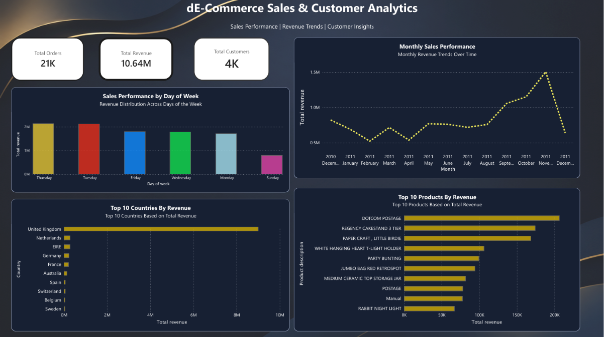
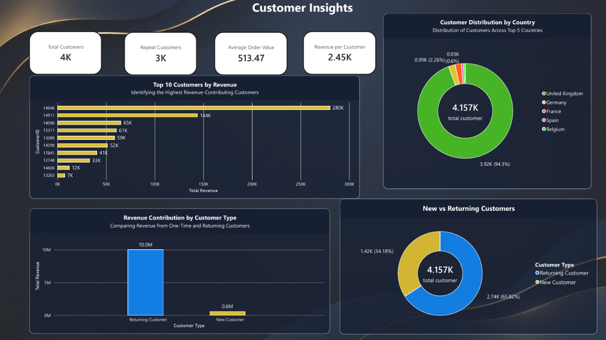
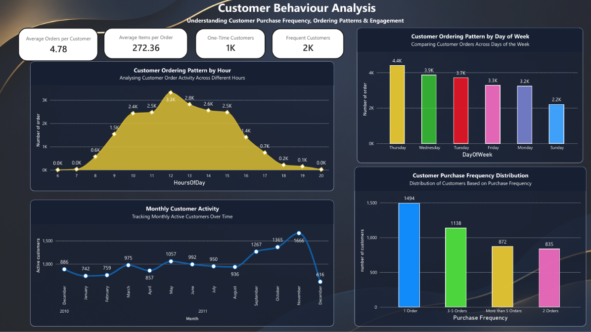
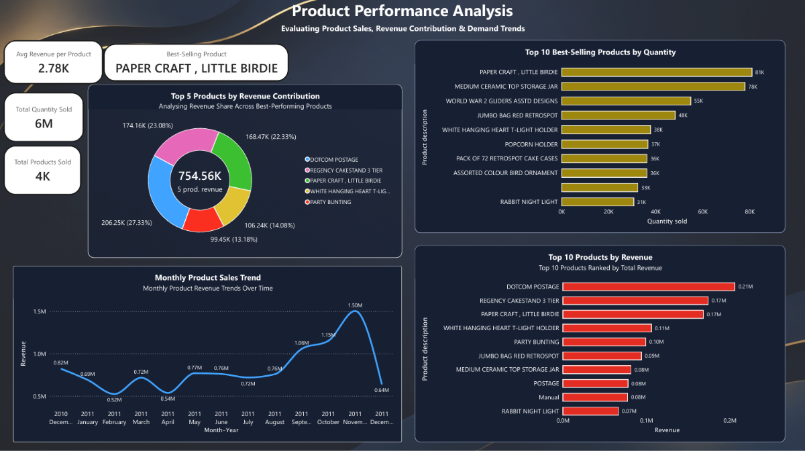

# E-Commerce Sales & Customer Analytics

## Project Overview

This project focuses on analysing e-commerce sales data to understand revenue performance, customer behaviour, product performance, and business trends.

The project uses Python for data understanding and cleaning, MySQL for SQL-based analysis, and Power BI for interactive dashboard development.

## Business Objectives

- Analyse overall sales and revenue performance.
- Identify top-performing products and countries.
- Understand customer purchasing behaviour.
- Analyse new and returning customers.
- Track monthly sales and customer activity.
- Generate meaningful business insights through data visualisation.

## Tools & Technologies

- **Python:** Data analysis and data cleaning
- **Pandas:** Data manipulation
- **Jupyter Notebook:** Exploratory data analysis
- **MySQL:** SQL queries and business analysis
- **Power BI:** Interactive dashboards and visualisation
- **VS Code:** Project development environment

## Project Workflow

### 1. Data Understanding & Cleaning – Python

- Explored the original Online Retail dataset.
- Identified missing values and duplicate records.
- Cleaned the dataset.
- Handled invalid and negative quantity records.
- Created a cleaned dataset for further analysis.

### 2. SQL Analysis – MySQL

Performed SQL-based analysis using:

- Aggregate functions
- GROUP BY and ORDER BY
- COUNT and DISTINCT
- Filtering and sorting
- Revenue analysis
- Customer analysis
- Product performance analysis

### 3. Dashboard Development – Power BI

Created a four-page interactive dashboard.

**Page 1 – Sales Overview**
- Total Orders
- Total Revenue
- Total Customers
- Monthly Sales Performance
- Top 10 Countries by Revenue
- Top 10 Products by Revenue
- Sales Performance by Day of Week

**Page 2 – Customer Insights**
- Repeat Customers
- Average Order Value
- Revenue per Customer
- Customer Distribution by Country
- New vs Returning Customers
- Top 10 Customers by Revenue

**Page 3 – Customer Behaviour Analysis**
- Average Orders per Customer
- One-Time Customers
- Frequent Customers
- Customer Purchase Frequency
- Ordering Patterns by Day and Hour
- Monthly Customer Activity

**Page 4 – Product Performance Analysis**
- Unique Products Sold
- Total Quantity Sold
- Best-Selling Product
- Average Revenue per Product
- Top 10 Products by Quantity
- Top 10 Products by Revenue
- Monthly Product Sales Trend

## Key Business Insights

- Total revenue generated: **10,642,110.80**
- Total orders: **20,726**
- Total customers: **4,339**
- Total quantity sold: **5,645,017**
- Returning customers contribute a larger share of revenue than new customers.
- The United Kingdom accounts for the majority of customer records.
- DOTCOM POSTAGE is among the highest-revenue products.

## Dashboard Screenshots

### 1. Sales Overview



### 2. Customer Insights



### 3. Customer Behaviour Analysis



### 4. Product Performance Analysis



## Project Structure

```text
Ecommerce-Sales-Customer-Analytics/
│
├── dashboard/
│   └── Ecommerce_Sales_Customer_Analytics.pbix
│
├── data/
│   ├── Online Retail.xlsx
│   ├── cleaned_online_retail.csv
│   └── ecommerce_analysis.sql
│
├── notebooks/
│   └── 01_Data_Understanding.ipynb
│
├── sql/
│   └── 01_data_exploration.sql
│
├── visuals/
│   ├── 01_Sales_Overview.png
│   ├── 02_Customer_Insights.png
│   ├── 03_Customer_Behaviour.png
│   └── 04_Product_Performance.png
│
└── README.md
```

## Conclusion

This project demonstrates an end-to-end e-commerce analytics workflow, combining Python, SQL, and Power BI to transform raw data into meaningful business insights and interactive visual reports.